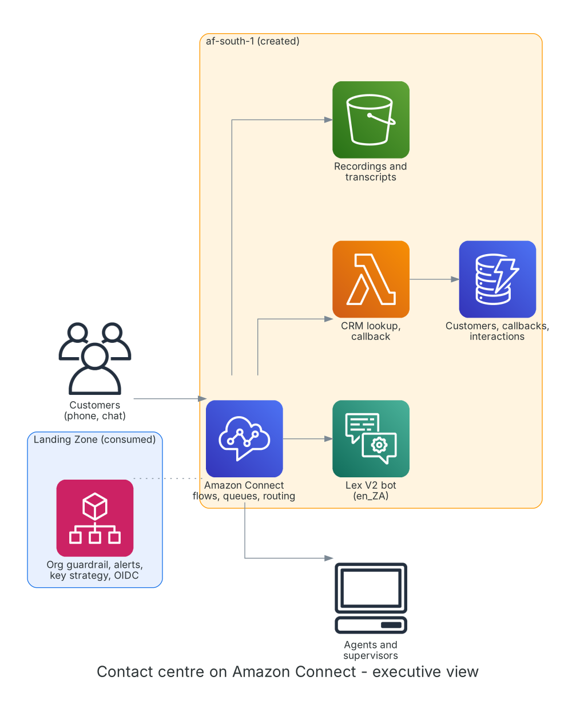
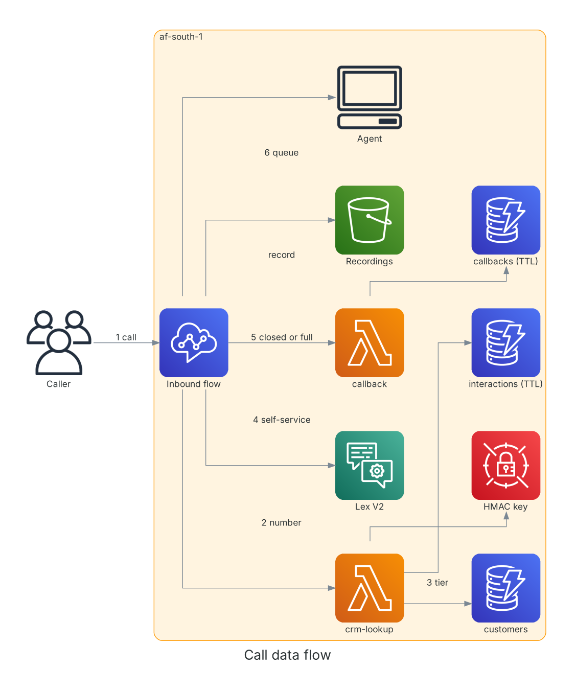
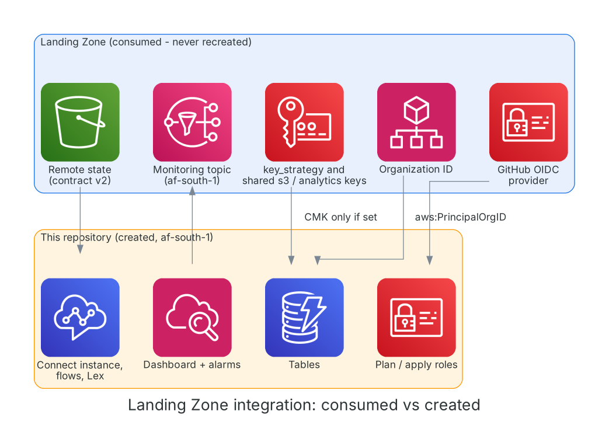
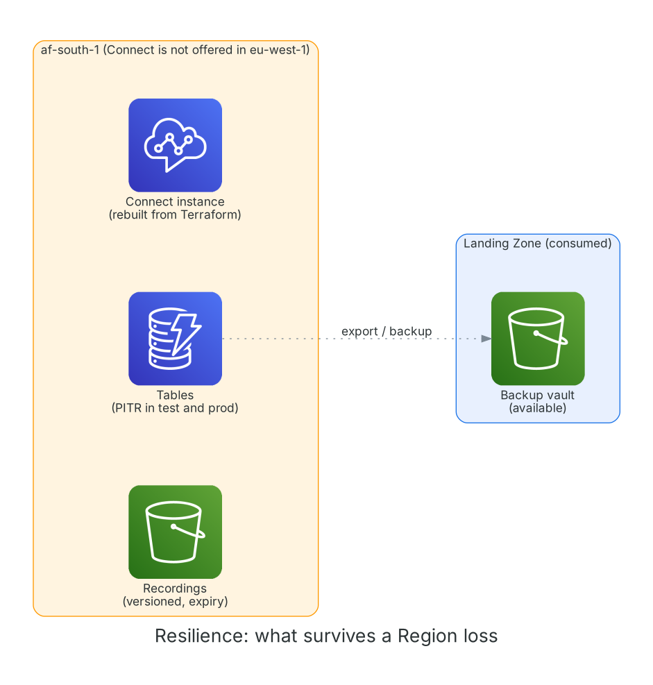
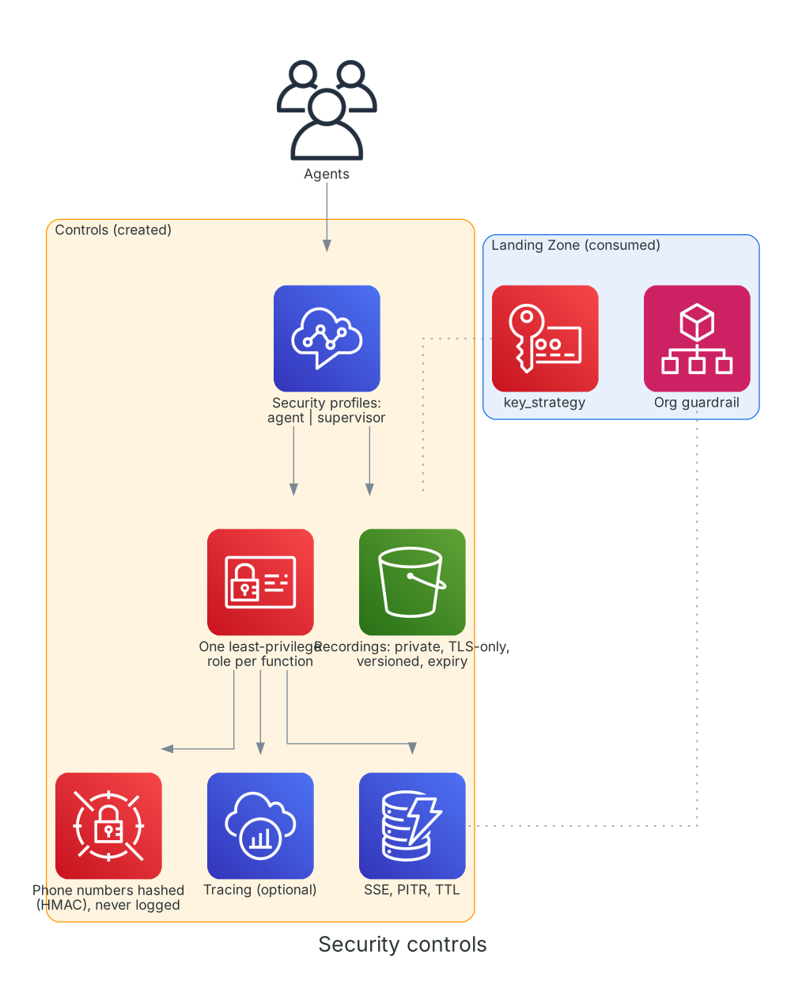
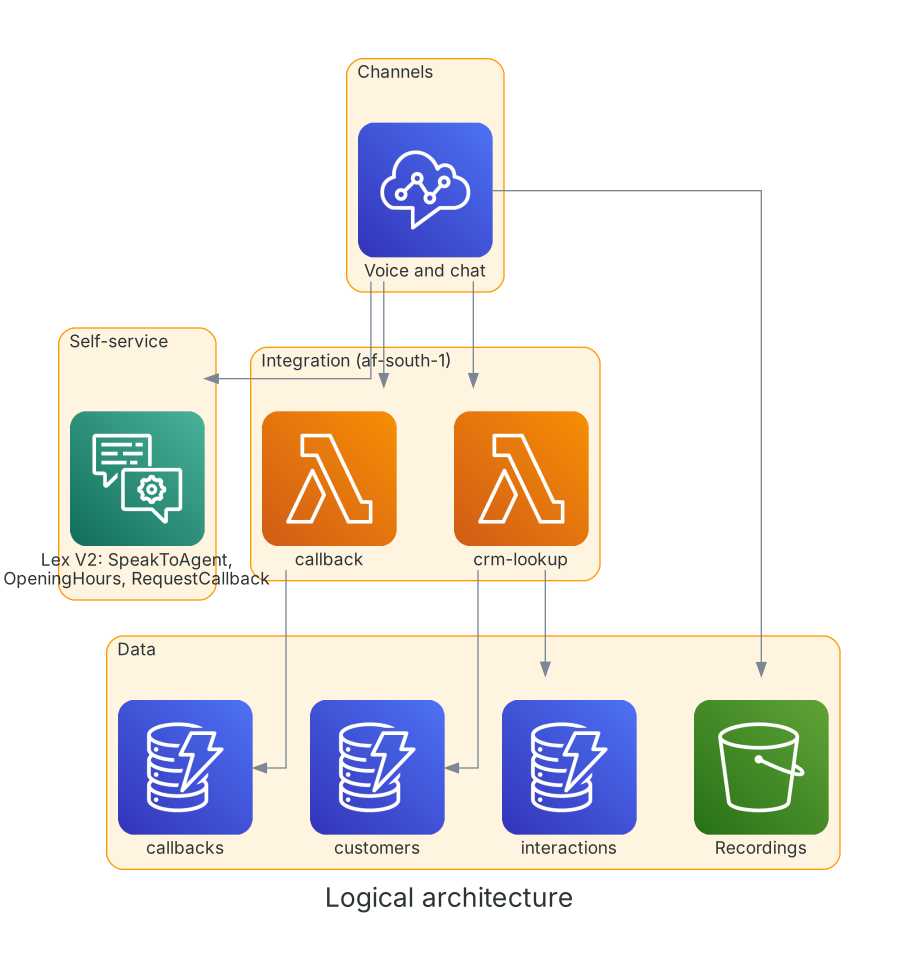

# aws-amazon-connect-contact-center

A cloud contact centre on Amazon Connect, built entirely with Terraform. Callers are greeted, looked up in a CRM table, offered Lex self-service (agent, opening hours, callback), and routed to a priority or general queue. When the centre is closed or the queue is full a callback is stored. Calls are recorded and analysed with Contact Lens.

This repository is standalone. Its only relationship to other repositories is the AWS Enterprise Landing Zone (LZ): everything the LZ already provides is read through `terraform_remote_state` and never recreated here.

Business case: [docs/BUSINESS-CASE.md](docs/BUSINESS-CASE.md) · Issues resolved: [docs/ISSUES-RESOLVED.md](docs/ISSUES-RESOLVED.md)

## Encryption and FinOps

Dev and Test use AWS-managed encryption keys (SSE-S3 on the recordings bucket, the AWS-managed key on DynamoDB and Secrets Manager). Prod uses customer-managed keys (CMK) where governance requires them, following the Landing Zone `key_strategy` output. The LZ currently publishes `key_strategy = "aws-managed"`, so this repository creates no keys and no key cost. Connect bills per minute of voice and chat, Lex per request, and a claimed phone number monthly; the guards are queue capacity, a concurrent-call alarm, recording expiry and no number claimed by default. See [docs/finops-and-kms.md](docs/finops-and-kms.md).

## Architecture



| Layer | Service | Region | Notes |
|---|---|---|---|
| Contact centre | Amazon Connect instance, hours, 2 queues, routing profile, 2 security profiles | af-south-1 | Connect-managed identities; agents are added in the console |
| Self-service | Amazon Lex V2 bot, `en_ZA`, alias `live` | af-south-1 | Intents: SpeakToAgent, OpeningHours, RequestCallback |
| Integration | 2 Lambda functions (`crm-lookup`, `callback`) | af-south-1 | One least-privilege role each |
| Data | DynamoDB `customers`, `callbacks` (TTL), `interactions` (TTL) | af-south-1 | Phone numbers are hashed for lookup |
| Recordings | S3 bucket, private, versioned, expiry | af-south-1 | Call recordings and chat transcripts |
| Analytics | Contact Lens post-call analytics, sentiment, redaction | af-south-1 | Set in the inbound flow |
| Operations | Dashboard, alarms, saved query, flow-error metric | af-south-1 | Alarms notify the LZ topic |
| Delivery | GitHub Actions with OIDC roles | af-south-1 | Roles trust the LZ OIDC provider |

### Call flow

1. The inbound flow turns on flow logging, recording and analytics, and greets the caller.
2. `crm-lookup` receives the caller number, hashes it and returns tier, language and segment (it fails open to a standard customer).
3. The flow picks the priority or general queue and checks the hours of operation.
4. Open: Lex asks how it can help. "Agent" or anything unrecognised goes to the queue, "opening hours" is answered and the menu repeats, "call back" stores a callback.
5. Closed or queue full: the caller hears a message and `callback` stores a request that expires after 7 days.



## Landing Zone integration



Consumed from LZ remote state: contract version, `key_strategy` and shared KMS keys, monitoring SNS topic, GitHub OIDC provider, organisation ID, state bucket. Details: [docs/landing-zone-integration.md](docs/landing-zone-integration.md).

## Regions and the Ireland rule

Every service used here is offered in `af-south-1`, so nothing is created in `eu-west-1` and the provider file declares no Ireland alias. Amazon Q in Connect and Voice ID are not offered in Cape Town and are not in the stack; Connect itself is not offered in Ireland, so there is no standby Region. Check date and sources: [docs/regional-availability.md](docs/regional-availability.md). Recovery model: [docs/dr-and-resilience.md](docs/dr-and-resilience.md).



## Providers

`aws` for almost everything. `awscc` (Cloud Control) fills three gaps: the Lex V2 bot with automatic build, the bot alias and its resource policy, and the Connect association of a Lex V2 bot. `archive` packages the Lambdas and `random` generates the pseudonymisation key. See [docs/DECISIONS.md](docs/DECISIONS.md).

## Security



Threat model: [docs/threat-model.md](docs/threat-model.md). Policy: [SECURITY.md](SECURITY.md). CI runs tfsec, checkov, trivy, gitleaks and bandit.

## Repository layout

| Path | Purpose |
|---|---|
| `provider.tf`, `landing_zone.tf`, `variables.tf`, `main.tf`, `outputs.tf` | Root module; `landing_zone.tf` reads LZ state and enforces its contract |
| `modules/connect` | Instance, recordings bucket, storage configs, hours, queues, routing and security profiles, optional number |
| `modules/contact-flows` | Inbound flow, Lambda permissions and associations, optional number association |
| `modules/lex-bot` | Lex V2 bot, version, alias, resource policy, Connect association |
| `modules/lambda` | Packaged functions with one role and one log group each |
| `modules/dynamodb` | The three tables |
| `modules/monitoring` | Dashboard, alarms, metric filter, saved queries |
| `modules/iam` | GitHub OIDC plan and apply roles |
| `lambda/` | Python handlers and the shared metrics helper |
| `tests/` | `python3 -I -m unittest discover -s tests` |
| `scripts/` | `tf.sh`, `ci-config.sh`, `generate-diagrams.py` |
| `docs/`, `runbooks/`, `architecture/diagrams/` | Documentation and the 8 diagrams |

## Deploy

Requirements: Terraform >= 1.10, AWS credentials for the target account, Python 3.12+.

```bash
cd environments/dev
cp backend.hcl.example backend.hcl                  # state bucket (from the LZ outputs)
cp terraform.tfvars.example terraform.tfvars        # LZ state location, owner, cost centre
cd ../..
scripts/tf.sh dev init
scripts/tf.sh dev plan
scripts/tf.sh dev apply
```

State key: `aws-amazon-connect-contact-center/<env>.tfstate`. Shared posture lives in `environments/common.tfvars`.

## Use

1. Open the `connect_access_url` output and create the first administrator.
2. Add agents, assign `<prefix>-agent` and the routing profile `<prefix>-standard`.
3. Load customer rows (hash the number with the key in the `pseudonymisation_secret_arn` secret).
4. Set `claim_phone_number = true` to claim a number and attach the inbound flow, then follow the acceptance checklist in [runbooks/operations.md](runbooks/operations.md).

## Documentation

[Business case](docs/BUSINESS-CASE.md) · [issues resolved](docs/ISSUES-RESOLVED.md) · [DECISIONS](docs/DECISIONS.md) · [threat model](docs/threat-model.md) · [DR and RTO/RPO](docs/dr-and-resilience.md) · [FinOps and KMS](docs/finops-and-kms.md) · [testing strategy](docs/testing-strategy.md) · [roadmap](docs/roadmap.md) · [regional availability](docs/regional-availability.md) · [Landing Zone integration](docs/landing-zone-integration.md) · [RBAC](docs/rbac.md) · [requirements mapping](docs/requirements-mapping.md) · [operations runbook](runbooks/operations.md)



Also in `architecture/diagrams`: `network-architecture.png` and `terraform-deployment.png`. Regenerate with `python3 scripts/generate-diagrams.py` (needs the `diagrams` package and Graphviz).

## Author

**Emmanuel Mulenga** — Multi-Cloud Engineer
- 🌐 [](https://www.linkedin.com/in/emmanuel-mulenga)
- 💻 [](https://github.com/e-mulenga)

---